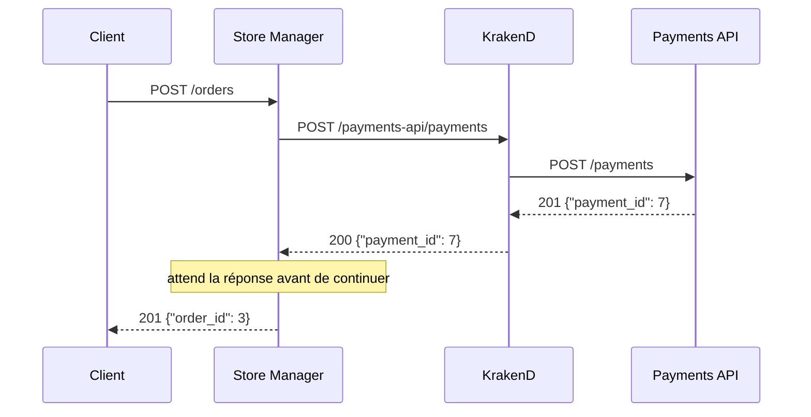
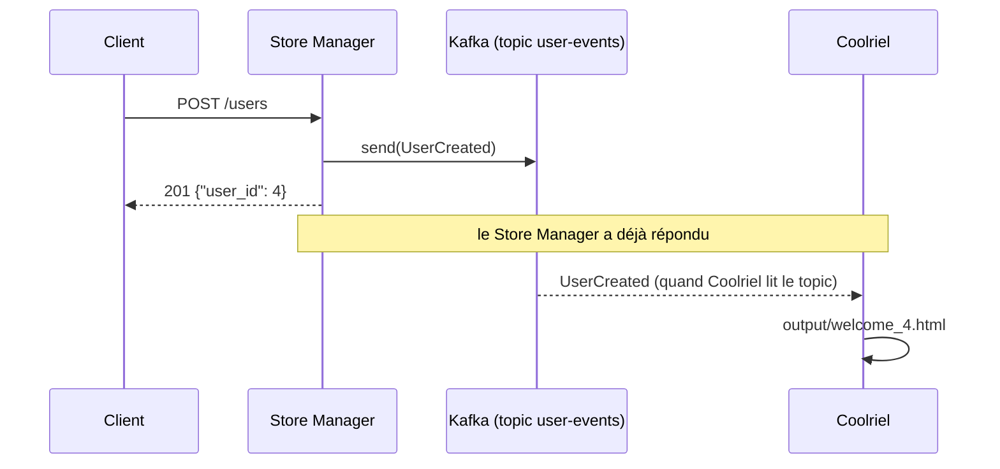

# Labo 07 – Réponse à la question 1

## Question 1

> Quelle est la différence entre la communication entre `store_manager` et `coolriel` dans ce labo et la communication entre `store_manager` et `payments_api` que nous avons implémentée pendant le labo 5 ? Expliquez avec des extraits de code ou des diagrammes et discutez des avantages et des inconvénients.

### En résumé

| | Labo 5 : Store Manager → Payments API | Labo 7 : Store Manager → Coolriel |
|---|---|---|
| Style | **Requête/réponse synchrone** (HTTP REST, via KrakenD) | **Événement asynchrone** (pub/sub, Kafka) |
| Qui connaît qui | Le Store Manager connaît l'URL du paiement et attend sa réponse | Le Store Manager publie dans le topic `user-events` et ne sait pas qui l'écoute |
| Le Store Manager attend ? | Oui, jusqu'à la réponse (ou le timeout de 5 s) | Non : `send()` dépose le message et la requête se termine |
| Besoin d'une réponse | Oui : le `payment_id` sert à construire le `payment_link` de la commande | Non : le courriel n'influence pas la création de l'utilisateur |
| Si le destinataire est arrêté | La commande est créée **sans lien de paiement** | Le message reste dans Kafka et sera traité au redémarrage |

### Labo 5 : appel HTTP synchrone

Dans `add_order` (`src/orders/commands/write_order.py`, `log430-labo5`), la création de la commande **s'arrête** pour appeler le service de paiement, et la suite dépend de sa réponse :

```python
new_order.payment_link = request_payment_link(new_order.id, total_amount, user_id)

def request_payment_link(order_id, total_amount, user_id):
    ...
    try:
        response_from_payment_service = requests.post(
            "http://api-gateway:8080/payments-api/payments",
            json=payment_transaction,
            headers={'Content-Type': 'application/json'},
            timeout=5
        )
        if response_from_payment_service.ok:
            payment_id = response_from_payment_service.json().get("payment_id")
    except requests.RequestException as e:
        logger.error(f"Service de paiement injoignable pour la commande {order_id} : {e}")

    if payment_id is None:
        logger.error(f"Aucun lien de paiement créé pour la commande {order_id}")
        return None
```



### Labo 7 : événement Kafka asynchrone

Dans `add_user` (`src/orders/commands/write_user.py`, `log430-labo5`), une fois l'utilisateur enregistré dans MySQL, le Store Manager **publie un événement** dans le topic `user-events`, puis retourne immédiatement. Il n'appelle pas Coolriel et n'attend aucune réponse :

```python
session.commit()

user_event_producer = UserEventProducer()
user_event_producer.get_instance().send('user-events', value={'event': 'UserCreated',
                                   'id': new_user.id,
                                   'name': new_user.name,
                                   'email': new_user.email,
                                   'datetime': str(datetime.datetime.now())})
return new_user.id
```

De son côté, Coolriel est un **consommateur** abonné au topic (`src/consumers/user_event_consumer.py`). Il lit les messages à son rythme et choisit le handler selon le champ `event` :

```python
self.consumer = KafkaConsumer(
    self.topic,                          # user-events
    bootstrap_servers=self.bootstrap_servers,
    group_id=self.group_id,              # coolriel-group
    auto_offset_reset=self.auto_offset_reset,
    value_deserializer=lambda m: json.loads(m.decode('utf-8')),
    enable_auto_commit=True
)
for message in self.consumer:
    self._process_message(message.value)   # -> UserCreatedHandler.handle(event_data)
```

`UserCreatedHandler` (`src/handlers/user_created_handler.py`) génère ensuite le courriel HTML à partir des données de l'événement seulement (`id`, `name`, `email`, `datetime`). Il ne rappelle jamais le Store Manager.



### Observation

**1. Coolriel en marche.** L'utilisateur 4 est créé, et Coolriel génère le courriel dans la même seconde :

```txt
$ curl -X POST localhost:5000/users -d '{"name":"Ada Test","email":"ada.…@test.ca"}'
{"user_id":4}   [HTTP 201, 0.19 s]

store_manager | "POST /users HTTP/1.1" 201 -
coolriel      | 20:19:09 - UserEventConsumer - DEBUG - Evenement : UserCreated
coolriel      | 20:19:09 - Handler - DEBUG - Courriel HTML généré à Ada Test (ID: 4), output/welcome_4.html
```

**2. Coolriel arrêté** (`docker stop coolriel`). Le Store Manager crée quand même l'utilisateur 5, encore plus vite, car il n'attend personne. Aucun courriel n'est généré :

```txt
$ curl -X POST localhost:5000/users -d '{"name":"Grace Offline","email":"grace.…@test.ca"}'
{"user_id":5}   [HTTP 201, 0.09 s]

$ ls output/
welcome_4.html
```

**3. Coolriel redémarré** (`docker start coolriel`). L'événement est resté dans Kafka : Coolriel reprend à son dernier offset (groupe `coolriel-group`) et traite le message manqué :

```txt
coolriel | 20:19:17 - UserEventConsumer - INFO - Démarrer un consommateur : coolriel-group
coolriel | 20:19:25 - UserEventConsumer - DEBUG - Evenement : UserCreated
coolriel | 20:19:25 - Handler - DEBUG - Courriel HTML généré à Grace Offline (ID: 5), output/welcome_5.html

$ ls output/
welcome_4.html  welcome_5.html
```

Au labo 5, avec le service de paiement arrêté, la même situation donne une commande **sans lien de paiement**. Le Store Manager attend aussi jusqu'à 5 s (le timeout) avant d'abandonner, et personne ne reprendra la demande plus tard.

### Avantages et inconvénients

**Synchrone (HTTP, labo 5)**

- ✅ Simple à écrire, à lire et à déboguer : un appel, une réponse, dans l'ordre.
- ✅ Le résultat est connu tout de suite. C'est indispensable ici, car le `payment_id` sert à construire le `payment_link` de la commande.
- ✅ Les erreurs sont visibles immédiatement par l'appelant (code HTTP).
- ❌ **Couplage temporel** : les deux services doivent être disponibles en même temps. Si le paiement est lent, la création de la commande est lente (latence additionnée). S'il est arrêté, la commande est incomplète.
- ❌ Le Store Manager connaît l'API du service de paiement (URL, format). Ajouter un autre destinataire oblige à modifier son code.
- ❌ Sous charge, chaque requête garde un thread et des connexions ouverts pendant l'appel (voir le test de charge du labo 5).

**Asynchrone (Kafka, labo 7)**

- ✅ **Découplage** : le Store Manager ne connaît pas Coolriel et ne dépend pas de sa disponibilité. La création d'utilisateur reste rapide, même si Coolriel est arrêté ou lent.
- ✅ **Pas de perte** : Kafka garde les messages ; un consommateur arrêté rattrape son retard au redémarrage (démontré ci-dessus).
- ✅ **Extensible** : un nouveau service (par exemple un service de statistiques) peut s'abonner à `user-events` sans modifier le Store Manager.
- ✅ Kafka absorbe les pics de charge : les consommateurs traitent les messages à leur rythme.
- ❌ **Cohérence à terme** seulement : au moment où le client reçoit `201`, le courriel n'existe pas encore. Il n'y a aucune réponse ni aucune confirmation de Coolriel.
- ❌ Plus d'infrastructure (un broker Kafka à exploiter) et plus difficile à déboguer : il faut suivre un message à travers le topic.
- ❌ Gestion d'erreurs plus délicate : si Coolriel échoue, le Store Manager ne le sait pas. De plus, `send()` est lui-même asynchrone et le code n'attend pas de confirmation de Kafka : si Kafka était indisponible, l'utilisateur serait créé dans MySQL sans que l'événement soit publié. C'est le problème que règle le patron Outbox (labo 8).
- ❌ Il faut gérer les doublons et l'ordre des messages (un message peut être relu après un redémarrage).

### Quand choisir l'un ou l'autre

Le choix dépend de **si l'appelant a besoin de la réponse pour continuer**. Le paiement doit rester synchrone tant que la commande a besoin du `payment_id`. Le courriel de bienvenue est un effet secondaire dont le Store Manager n'a pas besoin : un événement asynchrone est le meilleur choix.
