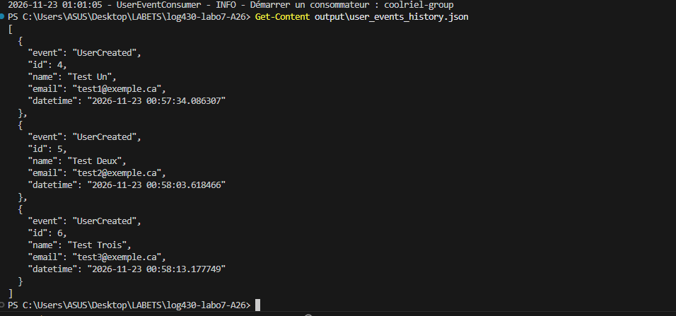

# Labo 07 – Question 5

> Combien d'événements avez-vous récupérés dans votre historique ? Illustrez avec le fichier JSON généré.

## Réponse

Au démarrage de Coolriel, le consommateur historique a relu **N événements** <!-- À COMPLÉTER : le nombre affiché dans les logs --> du topic `user-events`, depuis le tout premier message conservé par Kafka. Le log de Coolriel le confirme :

```text
<!-- À COMPLÉTER : coller les lignes des logs de Coolriel, par exemple :
UserEventHistoryConsumer - INFO - Démarrer un consommateur : coolriel-group-history
UserEventHistoryConsumer - INFO - N événement(s) historique(s) enregistré(s) dans output/user_events_history.json
UserEventHistoryConsumer - INFO - Arrêter le consommateur!
UserEventConsumer - INFO - Démarrer un consommateur : coolriel-group
-->
```

Ces événements correspondent aux utilisateurs créés et supprimés pendant les activités précédentes : <!-- À COMPLÉTER : X événements UserCreated et Y événements UserDeleted -->.

Le fichier complet est dans [`user_events_history.json`](user_events_history.json). En voici un extrait :

```json
<!-- À COMPLÉTER : coller les 2 ou 3 premiers événements du fichier -->
```



## Comment le consommateur récupère l'historique

Le consommateur (`src/consumers/user_event_history_consumer.py`) diffère du consommateur normal sur quatre paramètres :

```python
self.consumer = KafkaConsumer(
    self.topic,
    bootstrap_servers=self.bootstrap_servers,
    group_id=self.group_id,                       # "coolriel-group-history"
    auto_offset_reset=self.auto_offset_reset,     # "earliest"
    consumer_timeout_ms=self.consumer_timeout_ms, # 5000
    value_deserializer=lambda m: json.loads(m.decode('utf-8')),
    enable_auto_commit=False
)
```

- **`group_id` distinct** (`coolriel-group-history`) : si les deux consommateurs partageaient le même groupe, Kafka leur répartirait la partition et chacun ne lirait qu'une partie des événements.
- **`auto_offset_reset="earliest"`** : un groupe qui n'a aucune position enregistrée commence au premier message conservé, et non à la fin du topic (`latest`, ce qu'utilise le consommateur normal).
- **`consumer_timeout_ms=5000`** : la boucle `for message in self.consumer` se termine 5 secondes après le dernier message, au lieu d'attendre indéfiniment. Coolriel peut donc ensuite démarrer le consommateur normal.
- **`enable_auto_commit=False`** : le groupe ne mémorise jamais sa position. À chaque redémarrage de Coolriel, l'historique est donc relu en entier, ce qui est le comportement attendu d'un consommateur d'event sourcing.

Les événements sont accumulés dans une liste, puis écrits **une seule fois** après la boucle, pour éviter une opération d'écriture sur le disque à chaque événement :

```python
for message in self.consumer:
    self.events.append(message.value)

with open(self.output_file, 'w', encoding='utf-8') as f:
    f.write(json.dumps(self.events, indent=2, ensure_ascii=False))
```

Dans `src/coolriel.py`, le consommateur historique est démarré **avant** `UserEventConsumer`. Comme `start()` bloque jusqu'à la fin de l'historique, le consommateur normal ne commence qu'une fois l'historique entièrement relu.

Cet historique n'existe que parce que Kafka a été configuré pour conserver les messages (activité 5 : `KAFKA_LOG_RETENTION_HOURS: 168`, soit 7 jours) : sans rétention, les messages déjà consommés ne seraient plus disponibles.
